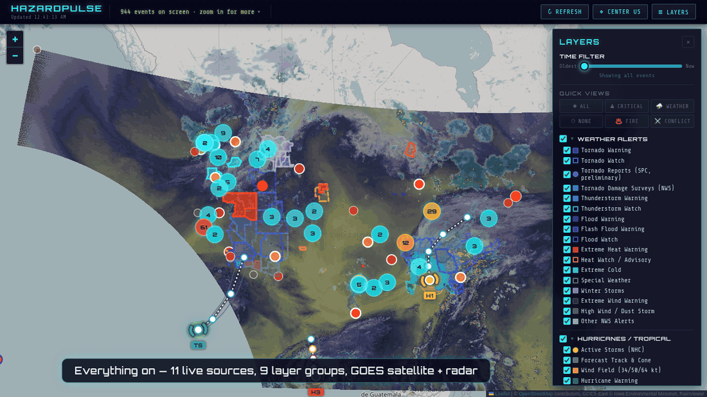

# HazardPulse

[](Dockerfile)
[](backend/package.json)

Real-time crisis map for the United States. One command to run. No API keys. No accounts. No cost.

**7 data sources** — NOAA weather, USGS earthquakes, NASA wildfires, GDELT conflict, FEMA emergency alerts, 911 dispatch, satellite imagery, and precipitation radar — all free, all updating automatically.

**What you get:**
- Live interactive map with 2,000+ events updating on a schedule
- 7 layer groups you can toggle independently (weather, tropical, seismic, fire, emergency, dispatch, conflict, satellite/radar)
- Quick-view presets to switch between crisis types in one click
- Time slider to filter by recency
- Zoom-based filtering — overview at country level, full detail as you zoom in
- Severity-weighted display — critical events pop, minor ones fade
- Broadcastify scanner links to listen to local emergency radio
- Every event automatically tagged with state, county, and city via Census boundary data
- Self-hosted with Docker — your data, your server

```bash
docker compose up -d
# → http://localhost:3000
```



---

## Install

### Prerequisites

- [Docker](https://docs.docker.com/get-docker/) (includes Docker Compose)

That's it. No Node.js, no database setup — Docker handles everything.

### Setup

```bash
# 1. Clone the repo
git clone https://github.com/abontherun-lang/hazardpulse.git
cd hazardpulse

# 2. (Optional) Set your contact email for NOAA
cp .env.example .env
#    Edit .env and replace your-email@example.com with your email.

# 3. Start the app
docker compose up -d
```

Open **http://localhost:3000** in your browser.

**First startup takes ~3-5 minutes** — it downloads Census TIGER/Line boundary data for reverse geocoding and fetches initial data from all sources. Subsequent starts are instant (data persists in Docker volumes).

### Access from other devices on your network

Find your machine's local IP and share it:

```bash
# Linux
hostname -I | awk '{print $1}'

# macOS
ipconfig getifaddr en0
```

Then open `http://<YOUR_IP>:3000` on any device on the same network.

### Updating

```bash
cd hazardpulse
git pull
docker compose build
docker compose up -d
```

### Stopping

```bash
docker compose down          # Stop (keeps data)
docker compose down -v       # Stop and clear all data (TIGER reloads on next start)
```

---

## Data Sources

| Source | Data | Update Interval | Cost |
|--------|------|-----------------|------|
| NOAA Weather API | Severe weather, floods, fire warnings, hurricanes, tsunami | 15 min | Free |
| USGS Earthquake API | Earthquake detections with magnitude and depth | 5 min | Free |
| NASA FIRMS | Satellite wildfire detections (VIIRS sensor) | 3 hours | Free |
| GDELT Project | Armed violence, protests, use of force (news-derived) | 15 min | Free |
| FEMA IPAWS | Evacuations, law enforcement, AMBER/Silver alerts | 15 min | Free |
| 911 Dispatch | Municipal CAD feeds (Seattle, SF, Austin, Cincinnati, Indianapolis) | 10 min | Free |
| Iowa State Mesonet | GOES satellite imagery (IR, visible, water vapor) | On demand | Free |
| RainViewer | Precipitation radar | On demand | Free |

## Under the Hood

- **PostgreSQL + PostGIS** persistent storage with normalized event schema
- **Census TIGER/Line** boundary data for automatic reverse geocoding (state, county, city)
- **Scanner links resolved via DB join** — 27,302 Broadcastify channels matched by county/city
- NOAA alerts geocoded via bundled UGC zone centroids (7,880 zones)
- GDELT noise reduction — unreliable CAMEO codes dropped, multi-source confirmation required
- FEMA IPAWS alerts routed to correct layers (emergencies, missing persons, fire)
- Redis response cache with ETag/304 support
- Gzip compression, rate limiting, XSS sanitization

## Configuration

All defaults work out of the box. To customize, copy `.env.example` to `.env`:

```bash
cp .env.example .env
```

| Variable | Default | Purpose |
|---|---|---|
| `PORT` | `3000` | Host port for the web UI and API |
| `USER_AGENT` | `HazardPulse/1.0, your-email@example.com` | NOAA contact info (recommended) |
| `ALLOWED_ORIGINS` | *(open)* | Comma-separated CORS origins for production |
| `NODE_ENV` | `production` | Set to `development` for verbose logging |

Or edit `docker-compose.yml` directly — it's well-commented with explanations for every setting.

## Troubleshooting

**App won't start / port conflict:**
```bash
# Check if something else is using port 3000
lsof -i :3000
# Use a different port:
PORT=8080 docker compose up -d
```

**First startup is slow:**
This is normal. The PostGIS container downloads ~75MB of Census boundary data on first init. Check progress with `docker compose logs -f db`. Subsequent starts are instant.

**No data showing on the map:**
```bash
# Check the logs — API fetch errors will show here
docker compose logs -f hazardpulse
```
The first startup needs internet access to reach NOAA, USGS, NASA, GDELT, and FEMA APIs. If you're behind a restrictive firewall, those requests may fail.

**Stale data after update:**
```bash
docker compose build
docker compose up -d
```

**Reset everything (fresh start):**
```bash
docker compose down -v       # Removes all volumes (TIGER data will re-download)
docker compose up -d
```

## Project Structure

```
hazardpulse/
├── docker-compose.yml         Two containers: app + PostGIS
├── Dockerfile                 Node.js + Redis (response cache)
├── start.sh                   Container entrypoint
├── .env.example               Environment variable template
├── backend/
│   ├── server.js              Express API + cron scheduling
│   ├── db.js                  PostgreSQL/PostGIS connection pool
│   ├── schema.sql             Database schema (events, source_meta, scanners)
│   ├── redis-client.js        Redis connection (response cache)
│   ├── ugc_centroids.json     NOAA zone geocoding lookup (7,880 zones)
│   ├── scripts/
│   │   ├── load-tiger.sh      Downloads Census TIGER boundary data into PostGIS
│   │   └── load-scanners.js   Imports Broadcastify scanner data into PostGIS
│   └── sources/               One module per data source
│       ├── common.js          Storage layer (storeEvent → PostGIS + reverse geocode)
│       ├── noaa.js            NOAA weather alerts
│       ├── usgs.js            USGS earthquakes
│       ├── firms.js           NASA FIRMS wildfires
│       ├── gdelt.js           GDELT conflict/unrest
│       ├── fema.js            FEMA IPAWS emergency alerts
│       ├── dispatch.js        911 dispatch aggregator
│       ├── dispatch-feeds.json Feed configs for 5 cities
│       └── adapters/          Platform-specific API adapters
│           ├── socrata.js     Socrata SODA API adapter
│           └── arcgis.js      ArcGIS FeatureServer adapter
├── frontend/
│   ├── index.html             Map UI + layer panel
│   ├── app.js                 Leaflet map + data rendering
│   ├── styles.css             UI styles
│   └── scanner_lookup.json    Source data for scanner DB table (27,302 entries)
└── docs/                      Documentation and research
```

## Adding a New Data Source

1. Create `backend/sources/yoursource.js` (copy `usgs.js` as a template)
2. Export `{ fetch, getActive, SOURCE_NAME, CRON_SCHEDULE, PREFIX }`
3. Add `require('./sources/yoursource')` to the `SOURCES` array in `server.js`
4. Add the layer checkbox to `frontend/index.html` and layer group to `frontend/app.js`

Cron scheduling, caching, PostGIS storage, and reverse geocoding are automatic. See [CONTRIBUTING.md](CONTRIBUTING.md) for details.

## Documentation

| File | Description |
|------|-------------|
| [docs/architecture.md](docs/architecture.md) | System design, tech stack, data flow, and schema |
| [docs/data-sources.md](docs/data-sources.md) | Active and planned data sources with API details |
| [docs/roadmap.md](docs/roadmap.md) | Development status and future plans |
| [docs/gdelt-filtering.md](docs/gdelt-filtering.md) | GDELT data quality analysis and filtering |
| [docs/power-outages.md](docs/power-outages.md) | Kubra StormCenter integration research |
| [docs/data-sources-research.md](docs/data-sources-research.md) | 20+ US government API research |
| [docs/civil-incidents-research.md](docs/civil-incidents-research.md) | 911/CAD dispatch data sources research |

## Disclaimer

HazardPulse is an informational tool that aggregates publicly available data. It is **not a substitute for official emergency services, government warnings, or professional emergency management guidance**. Do not rely on this tool for life-safety decisions. Always follow directives from local authorities and official sources like weather.gov and FEMA. This software is provided "AS IS" without warranty of any kind.

## Data Attribution

NOAA/NWS · U.S. Geological Survey · NASA FIRMS · [GDELT Project](https://www.gdeltproject.org/) · FEMA IPAWS · U.S. Census Bureau (TIGER/Line) · Iowa Environmental Mesonet (Iowa State University) · RainViewer · [Broadcastify](https://www.broadcastify.com/) · OpenStreetMap contributors
