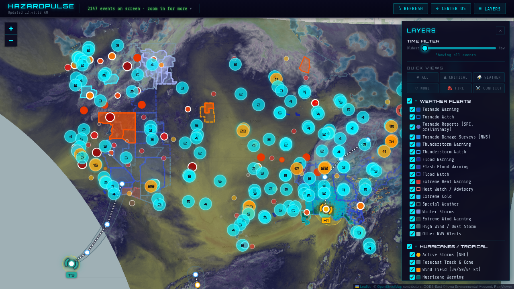

# HazardPulse

[](https://github.com/abontherun-lang/hazardpulse/actions/workflows/ci.yml)
[](LICENSE)
[](docker-compose.yml)
[](backend/package.json)

Real-time crisis map for the United States. One command to run. No API keys. No accounts. No cost.


**11 polled data sources** — NOAA weather alerts, NHC hurricane tracks and cones, USGS earthquakes, NASA satellite wildfire detections, NIFC named fire incidents, SPC preliminary tornado reports, NWS tornado damage surveys, USGS volcano alerts, GDELT conflict events, FEMA emergency alerts, and 911 dispatch feeds — plus live GOES satellite imagery and precipitation radar. All free, all updating automatically.

**What you get:**
- Live interactive map tracking ~1,500 events at a time, refreshed on per-source schedules
- 9 layer groups you can toggle independently — weather, hurricanes/tropical, earthquakes/tsunami, wildfires, volcanoes, emergency alerts, 911 dispatch, civil/conflict, satellite & radar
- 6 one-click Quick Views: All, Critical (life-safety only), Weather, None (blank slate), Fire, Conflict
- Satellite fire detections cross-checked against official NIFC incidents — high-intensity or corroborated fires only, not industrial/agricultural thermal noise
- Surveyed tornado tracks with EF ratings, path length and casualties from the NWS Damage Assessment Toolkit, beside SPC's preliminary reports
- Time slider to filter by recency, zoom-based filtering, severity-weighted display
- Every event reverse-geocoded to state, county, and city via Census boundary data
- One-click Broadcastify links to listen to local emergency scanners near any event
- Local weather conditions and home-base pin (auto-located or pinned via config)
- Self-hosted with Docker — your data, your server

```bash
docker compose up -d
# → http://localhost:3000
```

---

## Install

### Prerequisites

- [Docker](https://docs.docker.com/get-docker/) (includes Docker Compose)

That's it. No Node.js, no database setup — Docker handles everything.

### Setup

```bash
# 1. Clone the repo
git clone https://github.com/abontherun-lang/hazardpulse.git
cd hazardpulse

# 2. (Optional) Set your contact info for NOAA
cp .env.example .env
#    Edit .env and replace your-email@example.com with your email.

# 3. Start the app
docker compose up -d
```

Open **http://localhost:3000** in your browser.

`docker compose up` pulls a prebuilt image published by CI on every merge to main — no local build. To build from source instead (e.g. after modifying the code), use `docker compose up -d --build`.

**First startup takes ~3-5 minutes** — it downloads Census TIGER/Line boundary data for reverse geocoding and fetches initial data from all sources. Subsequent starts are instant (data persists in Docker volumes).

### Access from other devices on your network

Find your machine's local IP and share it:

```bash
# Linux
hostname -I | awk '{print $1}'

# macOS
ipconfig getifaddr en0
```

Then open `http://<YOUR_IP>:3000` on any device on the same network.

### Updating

```bash
cd hazardpulse
git pull
docker compose pull hazardpulse
docker compose up -d
```

Every CI build is also tagged with its commit (`sha-6b6f575`). To pin a
version, or roll back after a bad update, set `HAZARDPULSE_IMAGE` in `.env`
to that tag and run `docker compose up -d` again.

### Stopping

```bash
docker compose down          # Stop (keeps data)
docker compose down -v       # Stop and clear all data (TIGER reloads on next start)
```

---

## Data Sources

| Source | Data | Update Interval | Cost |
|--------|------|-----------------|------|
| NOAA Weather API | Every NWS warning except marine products, plus selected watches and advisories | 15 min | Free |
| USGS Earthquake API | Earthquake detections with magnitude and depth | 5 min | Free |
| NASA FIRMS | Satellite wildfire detections (VIIRS sensor) | 3 hours | Free |
| NIFC | Named wildfire incidents with acreage and containment | Hourly | Free |
| NWS SPC | Preliminary tornado reports (local storm reports, unrated) | 15 min | Free |
| NWS DAT | Surveyed tornado tracks with EF rating, path, injuries and fatalities | Hourly | Free |
| NHC | Active tropical cyclones: center by category, 5-day forecast track and cone, 34/50/64 kt wind field | 15 min | Free |
| USGS Volcano API | Volcano alert levels (elevated only) | Hourly | Free |
| GDELT Project | Armed violence, protests, use of force (news-derived) | 15 min | Free |
| FEMA IPAWS | Local-authority alerts: evacuations, law enforcement, AMBER/Silver (NWS-sent messages skipped, the NOAA feed has them) | 15 min | Free |
| 911 Dispatch | Municipal CAD feeds (Seattle, SF, Austin, Indianapolis) | 10 min | Free |
| Iowa State Mesonet | GOES satellite imagery (IR, visible, water vapor) | On demand | Free |
| RainViewer | Precipitation radar | On demand | Free |

## Under the Hood



- **PostgreSQL + PostGIS** persistent storage with normalized event schema
- **Census TIGER/Line** boundary data for automatic reverse geocoding (state, county, city)
- **Scanner links resolved via DB join** — 27,302 Broadcastify county/city IDs matched to events. Links open [Broadcastify](https://www.broadcastify.com/)'s public listen pages in a new tab; the lookup table is an index of their public county IDs compiled for interoperability — no audio is embedded, proxied, or rebroadcast
- NOAA alerts geocoded via TIGER county polygons, with bundled UGC zone centroids as fallback (7,880 zones)
- VIIRS fire detections gated by intensity or NIFC corroboration, with a TIGER border backstop
- GDELT noise reduction — unreliable CAMEO codes dropped, multi-source confirmation required
- FEMA IPAWS alerts routed to correct layers (emergencies, missing persons, fire)
- In-memory response cache with a content-hash ETag, so an unchanged map is a 304
- Gzip compression, rate limiting, XSS sanitization
- CI builds, tests, and publishes the Docker image to GHCR on every merge

## Configuration

All defaults work out of the box. To customize, copy `.env.example` to `.env`:

```bash
cp .env.example .env
```

| Variable | Default | Purpose |
|---|---|---|
| `PORT` | `3000` | Host port for the web UI and API |
| `HAZARDPULSE_IMAGE` | `…/hazardpulse:latest` | Image to run; set to a `sha-<commit>` tag to pin or roll back |
| `USER_AGENT` | `HazardPulse/1.0, your-email@example.com` | NOAA contact info (recommended) |
| `DISPLAY_WINDOW_HOURS` | `72` | Rolling window of events shown on the map |
| `HOME_LAT` / `HOME_LON` / `HOME_LABEL` | *(auto)* | Home-base pin; defaults to server IP geolocation |
| `FIRE_AUTOADMIT_FRP` | `50` | MW threshold to auto-admit a satellite fire detection |
| `ALLOWED_ORIGINS` | *(open)* | Comma-separated CORS origins for production |
| `NODE_ENV` | `production` | Set to `development` for verbose logging |

See [.env.example](.env.example) for the full list, including the wildfire
corroboration-radius tuning knobs.

### Setting your home base

The map shows a home-base pin so you can see at a glance how close events are
to you. By default it's placed by geolocating your server's public IP
(city-level accuracy, resolved once at startup). To pin an exact location:

```bash
# 1. Get your coordinates — right-click anywhere in Google Maps and the
#    lat/long appears at the top of the context menu, or use openstreetmap.org
#    (right-click → "Show address").

# 2. Add them to .env (create it from the template if you haven't):
cp .env.example .env    # skip if .env already exists
```

```bash
# .env
HOME_LAT=41.8781
HOME_LON=-87.6298
HOME_LABEL=The Office        # optional pin label, defaults to "Home Base"
```

```bash
# 3. Restart to apply:
docker compose up -d
```

Clicking the pin shows your label and a link to nearby emergency scanners.
The coordinates stay in your environment file — `.env` is gitignored and
never committed — but they are visible to anyone who can open your map, so
don't expose the app publicly with a precise home location set.

## Troubleshooting

**App won't start / port conflict:**
```bash
# Check if something else is using port 3000
lsof -i :3000
# Use a different port:
PORT=8080 docker compose up -d
```

**First startup is slow:**
This is normal. The PostGIS container downloads ~75MB of Census boundary data on first init. Check progress with `docker compose logs -f db`. Subsequent starts are instant.

**No data showing on the map:**
```bash
# Check the logs — API fetch errors will show here
docker compose logs -f hazardpulse
```
The first startup needs internet access to reach NOAA, USGS, NASA, GDELT, and FEMA APIs. If you're behind a restrictive firewall, those requests may fail.

**Stale data after update:**
```bash
docker compose pull hazardpulse
docker compose up -d
```

**Reset everything (fresh start):**
```bash
docker compose down -v       # Removes all volumes (TIGER data will re-download)
docker compose up -d
```

## Project Structure

```
hazardpulse/
├── docker-compose.yml         Two containers: app + PostGIS
├── Dockerfile                 Node.js + PostGIS client tools
├── .env.example               Environment variable template
├── .github/workflows/ci.yml   Tests, Docker build, GHCR publish
├── backend/
│   ├── server.js              Express API + cron scheduling
│   ├── db.js                  PostgreSQL/PostGIS connection pool
│   ├── schema.sql             Database schema (events, source_meta, scanners, app_meta)
│   ├── migrations.js          One-shot data migrations
│   ├── layers.json / layers.js  The layer registry (groups, colors, legend, presets)
│   ├── http.js                One HTTP client for every upstream feed
│   ├── data/                  ugc_centroids.json (7,880 NOAA zones), scanner_lookup.json (27,302 Broadcastify ids)
│   ├── test/                  Unit tests (node:test, no DB or network needed)
│   ├── scripts/
│   │   ├── load-tiger.sh      Downloads Census TIGER boundary data into PostGIS
│   │   └── load-scanners.js   Imports Broadcastify scanner data into PostGIS
│   └── sources/               One module per data source
│       ├── common.js          Storage layer (storeEvents → PostGIS + reverse geocode)
│       ├── alert-policy.js    Which NWS alerts are shown (NOAA + FEMA)
│       ├── geo.js             FIPS tables, centroids, SAME code lookup
│       ├── noaa.js            NOAA weather alerts
│       ├── usgs.js            USGS earthquakes
│       ├── firms.js           NASA FIRMS satellite fire detections
│       ├── nifc.js            NIFC named wildfire incidents
│       ├── spc.js             SPC preliminary tornado reports
│       ├── dat.js             NWS DAT surveyed tornado tracks (EF ratings)
│       ├── nhc.js             NHC storm center, forecast track/cone, wind field
│       ├── volcano.js         USGS volcano alert levels
│       ├── gdelt.js           GDELT conflict/unrest
│       ├── fema.js            FEMA IPAWS emergency alerts
│       ├── dispatch.js        911 dispatch aggregator
│       ├── dispatch-feeds.json Feed configs for 4 cities
│       └── adapters/          Platform-specific API adapters
│           ├── socrata.js     Socrata SODA API adapter
│           └── arcgis.js      ArcGIS FeatureServer adapter
├── frontend/
│   ├── index.html             Map UI + layer panel
│   ├── app.js                 Leaflet map + data rendering
│   ├── styles.css             UI styles
│   └── vendor/                Leaflet + markercluster, served locally
└── docs/                      Documentation and research
```

## Adding a New Data Source

1. Create `backend/sources/yoursource.js` (copy `usgs.js` as a template)
2. Export `{ fetch, SOURCE_NAME, CRON_SCHEDULE, PREFIX }`
3. Add `require('./sources/yoursource')` to the `SOURCES` array in `server.js`
4. Register the new `category` in `backend/layers.json` (color, style, legend row) — the legend, status list and presets are generated from it

Cron scheduling, caching, PostGIS storage, and reverse geocoding are automatic. Keep parsing logic pure and add a test in `backend/test/`. See [CONTRIBUTING.md](CONTRIBUTING.md) for details.

## Documentation

| File | Description |
|------|-------------|
| [docs/architecture.md](docs/architecture.md) | System design, tech stack, data flow, and schema |
| [docs/data-sources.md](docs/data-sources.md) | Active and planned data sources with API details |
| [docs/roadmap.md](docs/roadmap.md) | Development status and future plans |
| [docs/gdelt-filtering.md](docs/gdelt-filtering.md) | GDELT data quality analysis and filtering |
| [docs/power-outages.md](docs/power-outages.md) | Kubra StormCenter integration research |
| [docs/data-sources-research.md](docs/data-sources-research.md) | 20+ US government API research |
| [docs/civil-incidents-research.md](docs/civil-incidents-research.md) | 911/CAD dispatch data sources research |

## License

HazardPulse is free software licensed under the [GNU Affero General Public License v3.0](LICENSE). You can run, modify, and redistribute it; if you offer a modified version as a network service, you must make your source available under the same license.

## Disclaimer

HazardPulse is an informational tool that aggregates publicly available data. It is **not a substitute for official emergency services, government warnings, or professional emergency management guidance**. Do not rely on this tool for life-safety decisions. Always follow directives from local authorities and official sources like weather.gov and FEMA.

Displayed data may be **delayed, incomplete, or inaccurate**: upstream sources update on their own schedules (see the intervals above), feeds can fail or change format without notice, news-derived events (GDELT) are machine-extracted and imperfect even after filtering, and satellite fire detections are statistical products, not confirmed incidents. No guarantee is made of availability, timeliness, or accuracy. This software is provided "AS IS" without warranty of any kind; see the [AGPL-3.0 license](LICENSE) for the full warranty and liability disclaimer.

## Data Attribution

NOAA/NWS · U.S. Geological Survey · NASA FIRMS · National Interagency Fire Center · [GDELT Project](https://www.gdeltproject.org/) · FEMA IPAWS · U.S. Census Bureau (TIGER/Line) · Iowa Environmental Mesonet (Iowa State University) · RainViewer · [Broadcastify](https://www.broadcastify.com/) · OpenStreetMap contributors
